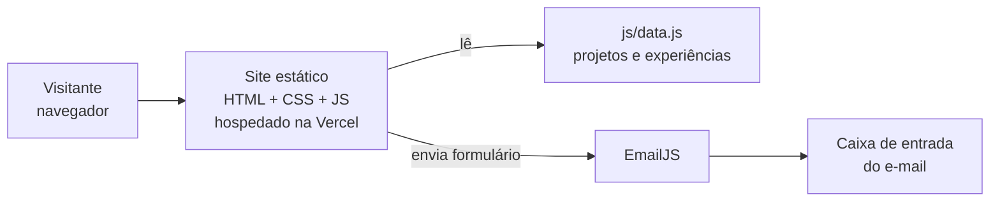

# 🏷️ Portfólio Profissional — Matheus 👨‍💻

> [!NOTE]
> Site de portfólio moderno e responsivo para apresentar minha trajetória, projetos, experiências e formas de contato, com versão em português e inglês.

<table>
  <tr>
    <td width="800px">
      <div align="justify">
        Este projeto é o <b>Laboratório 01 de DIAW</b> (Desenvolvimento e Integração de Aplicações Web), do curso de Engenharia de Software da PUC Minas. É um site de página única com quatro seções — <i>Sobre mim</i>, <i>Projetos</i>, <i>Experiências</i> e <i>Contato</i> — feito com HTML, CSS e JavaScript , hospedado gratuitamente na Vercel e com formulário de contato que envia e-mails pelo EmailJS.
      </div>
    </td>
    <td>
      <div>
        
      </div>
    </td>
  </tr>
</table>

---

## 🚧 Status do Projeto

🚧 **Em desenvolvimento**.


---

## 📚 Índice
- [Links Úteis](#-links-úteis)
- [Sobre o Projeto](#-sobre-o-projeto)
- [Funcionalidades Principais](#-funcionalidades-principais)
- [Tecnologias Utilizadas](#-tecnologias-utilizadas)
- [Arquitetura](#-arquitetura)
- [Instalação e Execução](#-instalação-e-execução)
- [Deploy](#-deploy)
- [Estrutura de Pastas](#-estrutura-de-pastas)
- [Demonstração](#-demonstração)
- [Documentações utilizadas](#-documentações-utilizadas)
- [Autores](#-autores)
- [Agradecimentos](#-agradecimentos)
- [Licença](#-licença)

---

## 🔗 Links Úteis
* 🌐 **Site publicado:** [https://vercel.com/matheus-77/portfolio](https://vercel.com/matheus-77/portfolio)
  > 💻 Aplicação em produção, hospedada na Vercel.
* 🎨 **Protótipos no Figma:** [https://www.figma.com/design/UTIuqKThOG7pkuZxnWWyUN/GranaUP-%25E2%2580%2594-Prot%25C3%25B3tipo-Interativo?node-id=6-600&t=acqJAWSzQx79mvaz-0](https://www.figma.com/design/UTIuqKThOG7pkuZxnWWyUN/GranaUP-%25E2%2580%2594-Prot%25C3%25B3tipo-Interativo?node-id=6-600&t=acqJAWSzQx79mvaz-0)
  > 📐 Wireframes de média fidelidade das quatro seções (desktop e mobile).

---

## 📝 Sobre o Projeto
- **Por que existe:** para reunir em um só lugar minha formação, meus projetos e minhas formas de contato, de modo acessível para professores, colegas e recrutadores.
- **Qual problema resolve:** substitui currículos soltos e links dispersos por uma página única, atualizável e bilíngue.
- **Contexto:** acadêmico (Laboratório 01 de DIAW, PUC Minas) e profissional (vitrine para estágios e oportunidades).
- **Onde pode ser utilizado:** como apresentação pessoal em processos seletivos e como referência de estrutura para outros portfólios estáticos.

> [!NOTE]
> Para atualizar o conteúdo (textos, projetos e experiências), basta editar o arquivo `js/data.js`; as seções são geradas automaticamente.

---

## ✨ Funcionalidades Principais

- 🌐 **Internacionalização (i18n):** seção "Sobre mim" em português e inglês, com troca por botão.
- 🕒 **Timeline dinâmica de projetos:** ordenada do mais antigo ao mais recente, com nome, descrição, tecnologias, link do GitHub e imagem/GIF.
- 💼 **Experiências:** instituição, atividade, período e descrição.
- 📨 **Contato:** links clicáveis (e-mail, WhatsApp, LinkedIn, GitHub) e formulário com envio por e-mail.
- ✅ **Validações básicas:** campos obrigatórios, e-mail válido e feedback de envio.
- 📱 **Design responsivo:** layout adaptado para desktop e celular.

---

## 🛠 Tecnologias Utilizadas

### 💻 Front-end
* **Linguagens:** HTML5, CSS3 e JavaScript (ES6+), sem framework
* **Estilização:** CSS puro (variáveis CSS, Flexbox, Grid e media queries)
* **Build Tool:** nenhuma (site estático)

### 🖥️ Back-end
* Não possui back-end próprio. O envio de e-mails é feito pelo serviço externo **EmailJS** (SDK `@emailjs/browser` v4, carregado via CDN).

### 🎨 Design
* **Figma:** wireframes de média fidelidade

### ⚙️ Infraestrutura & DevOps
* **Versionamento:** Git e GitHub
* **Cloud:** Vercel (deploy automático a cada push na branch `main`)

**Dependências e bibliotecas:** apenas o SDK do EmailJS (via CDN). Não há `npm install`.

---

## 🏗 Arquitetura

O site é um **front-end estático**: o navegador baixa HTML, CSS e JS da Vercel e tudo roda no cliente. Os dados (textos, projetos e experiências) ficam em `js/data.js`, e o `js/main.js` monta as seções. Só o formulário depende de serviço externo (EmailJS).



**Decisões arquiteturais**
- **HTML/CSS/JS puro:** simples, sem build, aceito pelo enunciado e fácil de manter.
- **EmailJS no lugar de um back-end:** permite enviar e-mail sem servidor próprio.
- **Dados separados da lógica:** adicionar um projeto exige editar apenas `data.js`.
- **Vercel:** deploy gratuito e automático a cada commit.

**Trade-offs:** a Public Key do EmailJS fica visível no código do front-end (esse é o uso previsto da chave pública); por isso o EmailJS limita o envio ao serviço e ao template configurados.

---

## 🔧 Instalação e Execução

### Pré-requisitos
* Um navegador moderno
* (Opcional) **Python 3** para servir o site localmente

### 🔑 Configuração (sem variáveis de ambiente)
Como o site é estático, não há arquivo `.env`. As chaves do EmailJS ficam no objeto `CONFIG` de `js/data.js`:

| Campo | Descrição |
| :--- | :--- |
| `publicKey` | Public Key da conta EmailJS |
| `serviceId` | ID do serviço de e-mail conectado |
| `templateId` | ID do template com as variáveis `{{name}}`, `{{email}}` e `{{message}}` |

> [!WARNING]
> Nunca coloque a **Private Key** do EmailJS no código do site.

### Executar localmente
```bash
git clone https://github.com/SEU_USUARIO/portfolio.git
cd portfolio

# Opção 1: abra o index.html no navegador
# Opção 2: sirva com Python
python -m http.server 8000
```
🎨 *O site estará disponível em **http://localhost:8000**.*

---

## 🚀 Deploy
1. Envie o projeto para um repositório público no GitHub.
2. Na [Vercel](https://vercel.com/), entre com o GitHub e clique em **Add New → Project**.
3. Importe o repositório `portfolio`, escolha **Framework Preset: Other**, deixe o comando de build vazio e clique em **Deploy**.
4. A cada `git push` na `main`, a Vercel publica uma nova versão automaticamente.

---

## 📂 Estrutura de Pastas

```
.
├── index.html              # 📄 Estrutura das quatro seções
├── README.md               # 📘 Documentação principal
├── LICENSE                 # ⚖️ Licença MIT
├── /css
│   └── style.css           # 🎨 Visual e responsividade
├── /js
│   ├── data.js             # 🗂️ Textos PT/EN, projetos, experiências e chaves do EmailJS
│   └── main.js             # ⚙️ Troca de idioma, timelines e formulário
└── /assets
    ├── /img                # 🖼️ Logo, imagens e GIFs dos projetos
    └── /prototipos         # 📐 Wireframes exportados do Figma
```

---

## 🎥 Demonstração

### 📐 Protótipos (Figma)

| Sobre mim | Projetos |
| :---: | :---: |
|  |  |
| **Experiências** | **Contato** |
|  |  |

### 🌐 Aplicação Web
<-- vou postar quando tiver mais aplicações -->
---

## 🔗 Documentações utilizadas

* 📖 **HTML, CSS e JavaScript:** [MDN Web Docs](https://developer.mozilla.org/pt-BR/)
* 📖 **Envio de e-mail:** [Documentação do EmailJS](https://www.emailjs.com/docs/)
* 📖 **Hospedagem:** [Documentação da Vercel](https://vercel.com/docs)
* 📖 **Protótipos:** [Figma](https://www.figma.com/pt-br/modelos/)
* 📖 **Padrão de commits:** [Conventional Commits](https://www.conventionalcommits.org/pt-br/v1.0.0/)

---

## 👥 Autore

| 👤 Nome | :octocat: GitHub | 💼 LinkedIn | 📤 E-mail |
|---------|-----------------|-------------|-----------|
| Matheus | [Matheus-77](https://github.com/Matheus-77) | [Matheus Oliveira](https://www.linkedin.com/in/matheus-oliveira-6aba6b404/) | [matheustorresoliveira67@gmail.com](mailto:matheustorresoliveira67@gmail.com) |

---

## 🙏 Agradecimentos

* [**Engenharia de Software PUC Minas**](https://www.instagram.com/engsoftwarepucminas/) - Pelo apoio institucional e estrutura acadêmica.
* [**Prof. Dr. João Paulo Aramuni**](https://github.com/joaopauloaramuni) - Pelo enunciado do laboratório e pelo template de README utilizado neste projeto.

---

## 📄 Licença

Este projeto é distribuído sob a **[Licença MIT](./LICENSE)**.